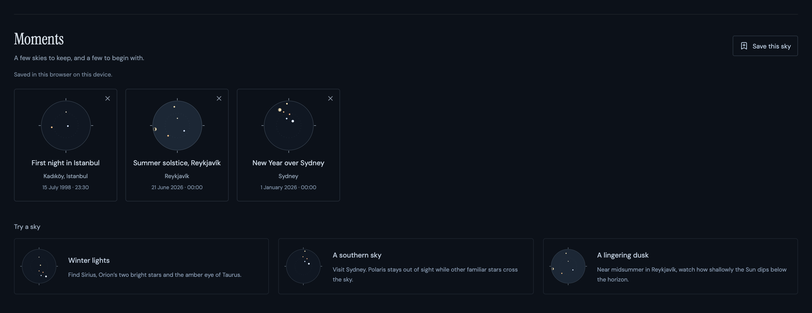
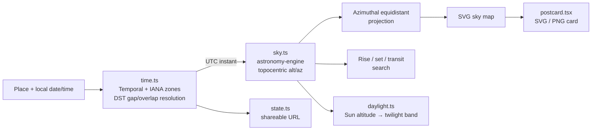

<div align="center">

# maps to the stars

**A quiet, browser-only sky explorer.**
Pick a place and any local moment between 1900 and 2100, then watch real, calculated stars and the Moon move across your sky.


<br />


</div>

---

## Why

Most sky apps are planetarium simulators with thousands of points and dozens of panels. **maps to the stars** does one thing gently: it shows _the sky above a place at a moment that matters to you_ — a birthday, a first night somewhere new, a summer evening decades ago — using real astronomical calculations, honest labelling, and nothing that needs a server.

- 🔭 **Real positions, not decoration.** Eight bright stars and the Moon, computed with precession, nutation, aberration and lunar parallax, independently checked against PyEphem.
- 🕰️ **Historical clocks done right.** Real IANA time-zone history, including DST gaps and overlaps — Istanbul isn't assumed to be UTC+3 in 1998.
- 🔒 **Private by default.** No accounts, no tracking, no backend. Everything runs in your browser; saved moments stay on your device.
- 🔗 **Shareable.** Every sky is a URL. Every sky can become a printable card.

## Gallery

<table>
  <tr>
    <td width="50%" valign="top">
      
      <p align="center"><b>Star trails</b> · Two hours of motion over Sydney. Polaris never rises here.</p>
    </td>
    <td width="50%" valign="top">
      
      <p align="center"><b>Daylight &amp; twilight</b> · Midsummer midnight in Reykjavík never gets past civil twilight.</p>
    </td>
  </tr>
  <tr>
    <td colspan="2">
      
      <p align="center"><b>Moments</b> · Keep up to 50 named skies in your browser, or begin with a curated starter sky.</p>
    </td>
  </tr>
  <tr>
    <td width="50%" valign="top" align="center">
      
      <p><b>Sky cards</b> · Download any moment as a self-contained SVG or a 1600 × 2240 PNG.</p>
    </td>
    <td width="50%" valign="top" align="center">
      
      <p><b>Made for phones too</b> · Fully responsive, touch- and keyboard-friendly.</p>
    </td>
  </tr>
</table>

## Quick start

Requires **Node.js 22.12+** (Node 24 LTS recommended).

```sh
git clone https://github.com/alpercandemir/maps-to-the-stars.git
cd maps-to-the-stars
npm ci
npm run dev
```

Open http://127.0.0.1:5173. No API key, account, database or environment variables are required.

| Command             | What it does                                      |
| ------------------- | ------------------------------------------------- |
| `npm run dev`       | Start the Vite dev server                         |
| `npm test`          | Scientific, time-zone and URL regression tests    |
| `npm run typecheck` | TypeScript checks                                 |
| `npm run build`     | Type-check and build the static site into `dist/` |
| `npm run preview`   | Serve the production build locally                |
| `npm run format`    | Format the codebase with Prettier                 |

## Features

### Explore

- **Any place.** Search 16 bundled cities, or enter exact latitude, longitude, a label and an IANA time zone. Optional “Use my location” fills the form only after you press it — the time zone still needs your confirmation.
- **Any moment, 1900–2100.** Jump with _Now_, _Tonight_ (today at 22:00), calendar day / month / six-month steps, or elapsed 24-hour steps.
- **Let time wander.** Scrub a 24-hour window or play forwards and backwards at 5, 30 or 120 simulated minutes per second. _Reset_ returns to your last explicit moment.
- **Trails · 2h.** Trace the previous two hours of stellar motion, fading into the past and clipped at the horizon. Works while paused, scrubbing or playing in either direction.
- **Daylight and twilight.** Day, civil, nautical and astronomical twilight, and night are derived from the Sun's calculated altitude, with a continuously changing sky tint.

### Understand

- **Object details.** Select any plotted object by mouse, touch or keyboard for altitude, azimuth, magnitude and the next rise, set and highest point.
- **Jump to events.** Click a rise, set or transit time to travel to that exact instant, keeping your selection — safe across DST overlaps.
- **Objects list.** Shows everything, including objects below the horizon, clearly labelled.

### Keep and share

- **Moments.** Save up to 50 named skies locally, each with a miniature calculated sky stamp. Reopening restores the precise instant, coordinates, zone, labels and trails. Removals can be undone.
- **Try a sky.** Three starter skies: winter stars over Istanbul, a southern sky over Sydney, and midsummer dusk in Reykjavík.
- **Share links.** The URL encodes the exact instant, location and zone; coordinates are never rounded.
- **Sky cards.** Export SVG (styles and fonts embedded) or PNG with your own title. Generated entirely client-side.

### Accessible by design

SVG map with north up, east right, zenith at centre and 30°/60° altitude rings. <kbd>Tab</kbd> navigates, <kbd>Enter</kbd> selects, <kbd>Space</kbd> plays/pauses, and arrow keys scrub time. Reduced-motion preferences disable decorative transitions.

## How it works



### Scientific model

[`astronomy-engine`](https://github.com/cosinekitty/astronomy) defines the eight J2000 stars with `DefineStar` and computes topocentric equatorial coordinates of date (precession, nutation, aberration), then converts them to altitude/azimuth. Lunar position includes topocentric parallax; phase and illuminated fraction are calculated independently of the icon.

Catalogue values are rounded J2000/ICRS coordinates, approximate V magnitudes and distances from [CDS SIMBAD](https://simbad.cds.unistra.fr/simbad/): **Polaris, Sirius, Vega, Arcturus, Betelgeuse, Rigel, Aldebaran and Capella.** Variable-star magnitudes are representative. No decorative points are presented as calculated stars.

The map uses an azimuthal equidistant projection:

```text
r = R × (90 − altitude) / 90
x = cx + r × sin(azimuth)
y = cy − r × cos(azimuth)
```

Only object centres at or above 0° altitude are drawn. Rise/set times are the next **geometric centre** crossings within 48 hours, found by 10-minute sampling and bisection to under one second; transit is the next upper meridian passage. Circumpolar and never-rising stars get explicit statuses. The observer is at sea level.

Solar context uses the same topocentric, unrefracted model. Twilight bands use centre altitudes of −6°, −12° and −18° ([USNO definitions](https://aa.usno.navy.mil/faq/RST_defs)). The app's 0° daylight boundary matches its geometric map and therefore differs slightly from conventional sunrise/sunset, which include the solar radius and refraction.

### Historical clock handling

[`@js-temporal/polyfill`](https://github.com/js-temporal/temporal-polyfill) converts wall time through the runtime's IANA time-zone database. The UI rejects spring-forward gaps and asks you to choose the earlier or later occurrence in fall-back overlaps, showing offsets and UTC timestamps. Calendar jumps preserve wall time; 24-hour jumps and playback operate on UTC instants.

URL state is `lat`, `lon`, `tz`, `place` and an ISO UTC timestamp `at`. Invalid or out-of-range links fall back to the default moment with a visible notice.

```text
/?lat=40.9909&lon=29.0297&tz=Europe%2FIstanbul&place=Kad%C4%B1k%C3%B6y%2C+Istanbul&at=2026-01-15T19%3A00%3A00.000Z
```

## Validation

**71 automated tests** (Vitest) cover:

- **45 independent position comparisons** — eight stars + Moon at five moments — against PyEphem 4.2.1 / libastro with refraction disabled in both engines. Cases include Istanbul (July 1998, January 2026), Sydney (January 2026), and January 1900/2100. **All angular separations are under 0.08°**; lunar illuminated-fraction differences are under 0.5 percentage points.
- Polaris circumpolarity, southern-hemisphere visibility, rise/set crossing direction and transit maxima.
- Projection geometry and 359° → 0° continuity.
- Trail fading, endpoints and deterministic reconstruction after jumps in either direction.
- Solar band boundaries, continuous tint, and polar seasonal behaviour.
- Moments round trips, corruption handling, denied/full storage and limits; SVG card metadata and escaping.
- Pre-2016 Turkish offsets and the delayed November 2015 transition, New York gaps/overlaps, Sydney and fractional-offset India.
- Calendar arithmetic, query validation and exact share-link round trips.

Browser QA covered desktop and 390 × 844 / 360 × 800 mobile viewports.

<details>
<summary>Regenerating the PyEphem reference fixtures (optional)</summary>

The fixtures live in `src/lib/__fixtures__/pyephem.json`. Python is not needed for the app or normal tests.

```sh
python3 -m venv /tmp/maps-to-the-stars-reference-venv
/tmp/maps-to-the-stars-reference-venv/bin/pip install ephem==4.2.1
/tmp/maps-to-the-stars-reference-venv/bin/python scripts/generate-references.py
```

These comparisons are engineering checks, not observatory-grade certification. See the [PyEphem documentation](https://rhodesmill.org/pyephem/quick.html).

</details>

## Deliberate limits

> [!NOTE]
> This is a **reconstructed astronomical sky, not a photograph.** Clouds, light pollution, terrain, extinction and refraction are not modelled; an object above the horizon may not be visible to the eye.

- Star proper motion is omitted (precession and nutation are included). Accuracy suits a visual explorer, not telescope pointing or navigation.
- Near a grazing horizon, rise/set pairs shorter than the 10-minute sampling interval may be missed. At the geographic poles, a daily highest point is degenerate.
- The Moon icon is schematic: its bright limb isn't rotated to the observer's sky orientation. Apparent sizes are symbolic.
- Early-1900s civil-time records may be incomplete and vary between platforms; future offsets follow currently installed rules. The UTC timestamp in the URL always fixes the instant.
- The bundled city list is small and hand-curated — no geocoder, map tiles, AI features, constellation overlay or backend.
- No service worker. Once loaded, calculations and city search need no network. Geolocation is optional and may require HTTPS outside localhost.

## Project structure

```text
src/
├── App.tsx                 single-screen experience and playback
├── style.css               responsive visual design
├── components/
│   ├── SkyMap.tsx          SVG sky map
│   ├── PlacePicker.tsx     city search and manual coordinates
│   ├── MomentsShelf.tsx    saved and starter skies
│   └── Dialog.tsx          accessible dialogs
└── lib/
    ├── catalog.ts          star catalogue and city data
    ├── time.ts             explicit local-time / DST resolution
    ├── sky.ts              positions, projection and events
    ├── daylight.ts         solar altitude, twilight bands and tint
    ├── trails.ts           two-hour trail reconstruction
    ├── state.ts            validated URL serialization
    ├── moments.ts          local collection and starter skies
    └── postcard.tsx        SVG / PNG sky cards (loaded on demand)
scripts/generate-references.py   PyEphem fixture generator
deploy/                          optional self-hosting recipe
```

## Deployment

`npm run build` produces a fully static site in `dist/` — deploy it to any static host (Netlify, Vercel, GitHub Pages, Cloudflare Pages, S3, nginx…). The app lives at the host root by default; set Vite's `base` for subdirectory hosting. Deep links use query parameters, so no rewrite rules are needed.

For self-hosting next to an existing Caddy reverse proxy, see [`deploy/README.md`](deploy/README.md) for a hardened, resource-limited Docker Compose recipe.

## Built with

[React 19](https://react.dev) · [TypeScript](https://www.typescriptlang.org) · [Vite](https://vite.dev) · [Astronomy Engine](https://github.com/cosinekitty/astronomy) · [Temporal polyfill](https://github.com/js-temporal/temporal-polyfill) · [Lucide](https://lucide.dev) · [Vitest](https://vitest.dev)

## Attribution

Astronomy Engine is MIT-licensed; React, Vite, Temporal and Lucide retain their upstream licenses. SIMBAD is operated at CDS, Strasbourg, France — please acknowledge CDS/SIMBAD when reusing the catalogue. DM Sans and Instrument Serif are bundled via Fontsource under the SIL Open Font License. PyEphem is used only to generate test fixtures and is not part of the client bundle.

<div align="center">
<br />
<i>Same sky. A different moment.</i>
</div>
