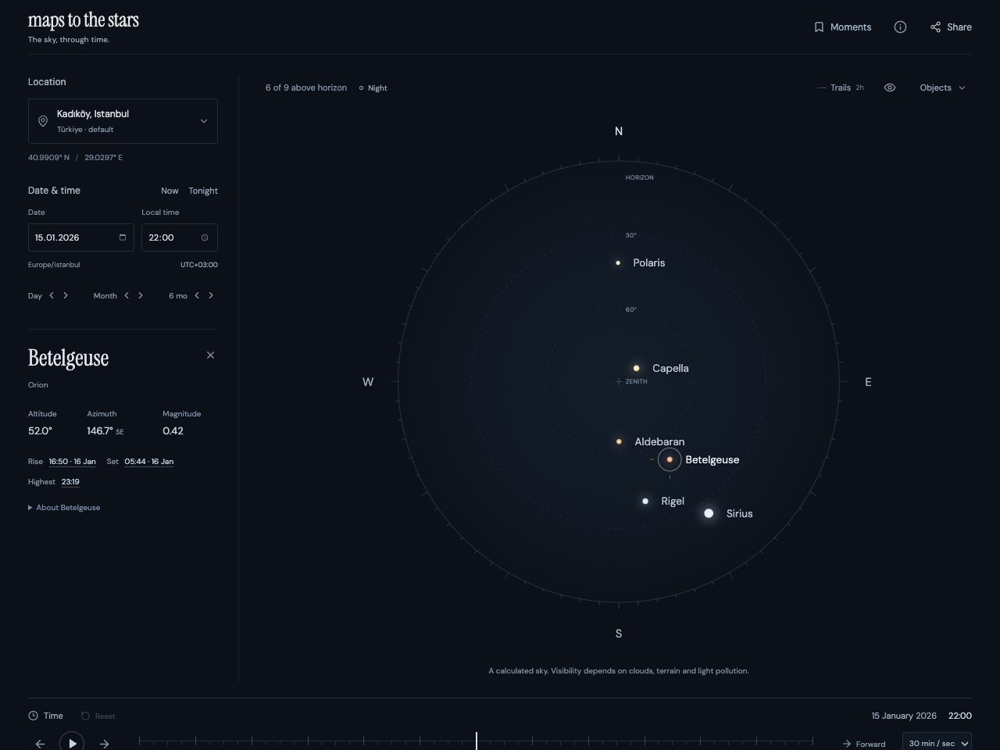
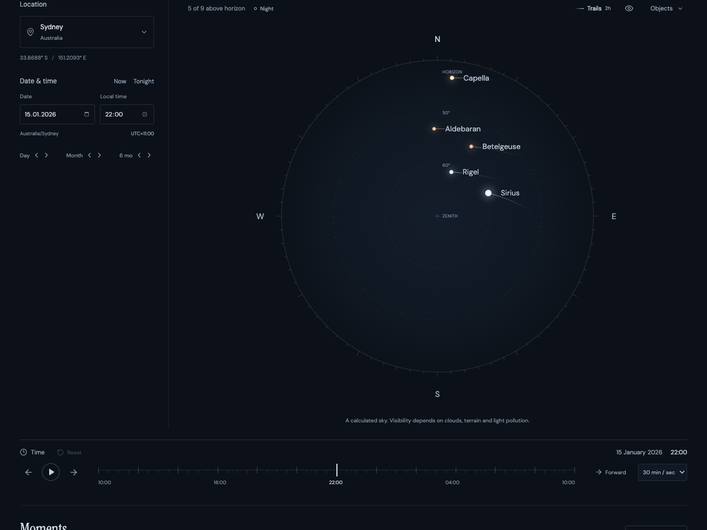
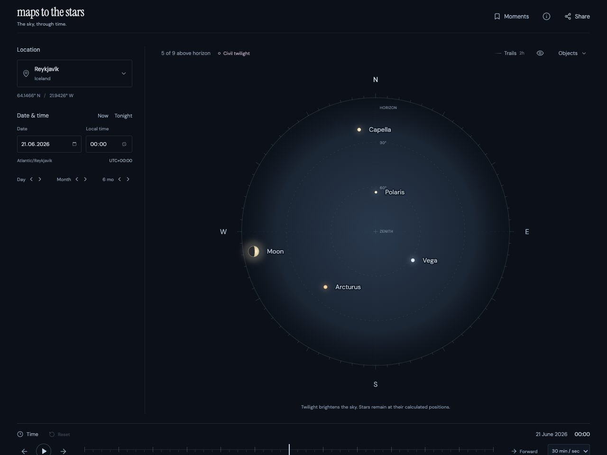
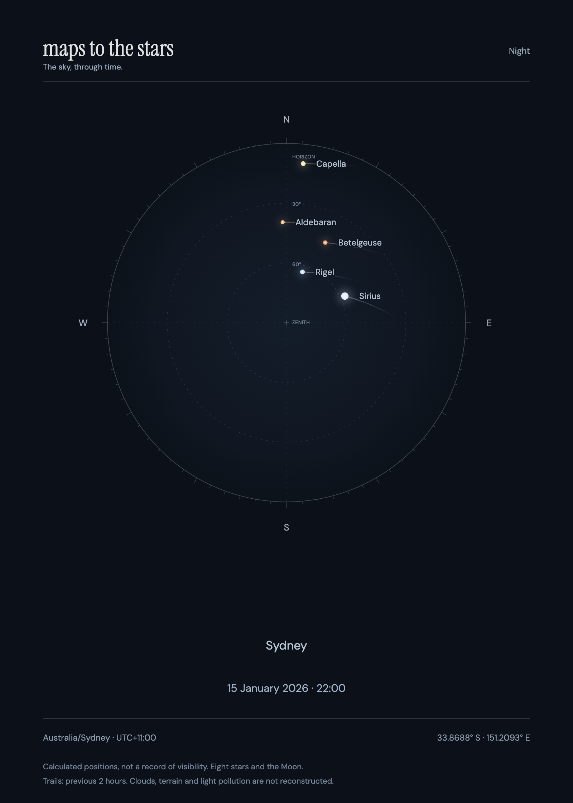
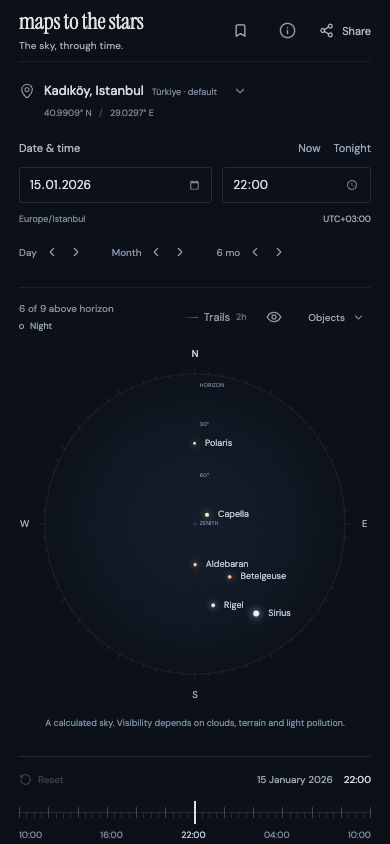

<div align="center">

# maps to the stars

**The sky, through time.**

Explore eight bright stars and the Moon from 1900 to 2100. Real astronomical calculations, historical time zones, and a quiet interface—all in your browser.

[](https://github.com/alpercandemir/maps-to-the-stars/actions/workflows/ci.yml)


[**Explore the live sky →**](https://tothestars.138.2.168.194.sslip.io/) · [Run locally](#run-locally) · [Astronomy & accuracy](docs/astronomy.md) · [Deployment](deploy/README.md)



</div>

## A short tour

https://github.com/user-attachments/assets/9d3807ea-616a-41bf-82ae-90a45738bb18

[Download the walkthrough](docs/demo/walkthrough.mp4). A real browser recording, under one minute, showing date changes, a rise jump, trails, light-travel years, starter skies and card export. [Recording instructions](docs/demo/README.md).

## What you can do

- **Find your sky.** Choose one of 16 cities or enter coordinates and an IANA time zone. Date and time edits update automatically after a brief pause.
- **Move through time.** Step by day or month, scrub a 24-hour window, or play in either direction. Historical DST gaps are rejected; repeated hours offer an explicit choice.
- **Follow the light.** Select stars for altitude, azimuth and the next rise, set or highest point. Nearby stars also show the approximate year their light left, with an option to explore that year's sky when it is in range.
- **See motion and daylight.** Trace the previous two hours of stellar motion, with calculated daylight and twilight changing the sky tint.
- **Keep a moment.** Save up to 50 named skies on your device. Share the exact instant and location in a URL, or export a card as self-contained SVG or 1600 × 2240 PNG, including Turkish characters.

No accounts, API keys, analytics, database or application backend. Calculations run locally. Saved Moments stay in browser storage; a shared URL includes the selected coordinates and time. “Use my location” requests geolocation only when pressed.

## Gallery

<table>
  <tr>
    <td width="50%" valign="top">
      
      <p align="center"><b>Star trails</b> · A southern sky in motion.</p>
    </td>
    <td width="50%" valign="top">
      
      <p align="center"><b>Daylight &amp; twilight</b> · Midsummer midnight in Reykjavík.</p>
    </td>
  </tr>
  <tr>
    <td width="50%" valign="top" align="center">
      
      <p><b>Sky cards</b> · A calculated sky to keep.</p>
    </td>
    <td width="50%" valign="top" align="center">
      
      <p><b>Desktop and mobile</b> · Touch and keyboard controls.</p>
    </td>
  </tr>
</table>

## Run locally

Use **Node.js 22.12+**; CI uses Node 24.

```sh
git clone https://github.com/alpercandemir/maps-to-the-stars.git
cd maps-to-the-stars
npm ci
npm run dev
```

Open [localhost:5173](http://127.0.0.1:5173). No environment variables are needed.

| Command             | Purpose                                                |
| ------------------- | ------------------------------------------------------ |
| `npm run dev`       | Start the development server                           |
| `npm test`          | Run astronomy, time-zone, state and export unit tests  |
| `npm run typecheck` | Check TypeScript                                       |
| `npm run build`     | Type-check and produce the static `dist/` bundle       |
| `npm run preview`   | Serve the production bundle locally                    |
| `npm run test:e2e`  | Check the production bundle in desktop/mobile Chromium |
| `npm run format`    | Format source and documentation                        |

For browser checks:

```sh
npx playwright install chromium
npm run build
npm run test:e2e
```

On Linux, use `npx playwright install --with-deps chromium` to install system dependencies too.

Keyboard: <kbd>Tab</kbd> moves between controls and stars; <kbd>Enter</kbd> selects a star; <kbd>Space</kbd> plays or pauses when controls are not focused. Arrow keys adjust the focused timeline. Decorative transitions respect reduced-motion preferences.

## Calculations and limits

[Astronomy Engine](https://github.com/cosinekitty/astronomy) calculates topocentric positions with precession, nutation, aberration and lunar parallax. [Temporal](https://github.com/js-temporal/temporal-polyfill) resolves local clock time using the browser's IANA time-zone data. The map has north up, east right, the zenith at its centre, and a geometric horizon at 0°.

The catalogue contains **Polaris, Sirius, Vega, Arcturus, Betelgeuse, Rigel, Aldebaran and Capella**, plus the Moon. Forty-five independent position comparisons against PyEphem are within 0.08°. CI also checks event direction, historical time zones, URL round trips, saved moments and card exports.

This is a calculated sky, not a record of what was visible. Clouds, terrain, light pollution, refraction and star proper motion are omitted. Rise/set times refer to geometric centre crossings; short grazing events can be missed by the ten-minute search sampling. Light-travel years use approximate catalogue distances. “Explore” changes the viewing date; it does not simulate following a photon. Dates outside 1900–2100 cannot be explored.

See [the scientific model, validation and limitations](docs/astronomy.md), including instructions for regenerating the independent fixtures.

## Deployment and CI/CD

`npm run build` produces static files in `dist/`, suitable for any static host. Query-string share links need no route rewrites. For subdirectory hosting, set Vite's `base` before building.

The [GitHub Actions workflow](.github/workflows/ci.yml) runs unit tests, TypeScript/build checks, desktop/mobile browser tests and deployment configuration validation on pull requests and main pushes. It retains the tested release archive for 14 days and browser failure reports for 7 days.

With deployment configured, successful main builds ship that exact archive to the existing Oracle/Caddy host, then verify HTTPS health. Deployments run one at a time; superseded automatic builds are skipped. Manual runs accept a full main-branch SHA for a validated rebuild and rollback. Failed activation restores the previous app release.

See [the deployment guide](deploy/README.md) for the server environment, GitHub secret/variables, activation and rollback instructions.

## Project map

```text
src/App.tsx           experience, date editing and playback
src/components/      SVG map, place picker, Moments and dialogs
src/lib/             astronomy, time, trails, state and card export
tests/               production browser regressions
docs/astronomy.md    model, independent validation and known limits
docs/demo/           short walkthrough
deploy/              Caddy/Compose and release helpers
.github/workflows/   CI and production deployment
```

## Credits

[React](https://react.dev) · [TypeScript](https://www.typescriptlang.org) · [Vite](https://vite.dev) · [Astronomy Engine](https://github.com/cosinekitty/astronomy) · [Temporal](https://github.com/js-temporal/temporal-polyfill) · [Lucide](https://lucide.dev) · [Vitest](https://vitest.dev) · [Playwright](https://playwright.dev)

Catalogue data: [CDS SIMBAD](https://simbad.cds.unistra.fr/simbad/), Strasbourg, France. DM Sans and Instrument Serif are bundled through Fontsource under the SIL Open Font License. Dependencies retain their upstream licenses. PyEphem generates development fixtures and is not included in the browser bundle.
