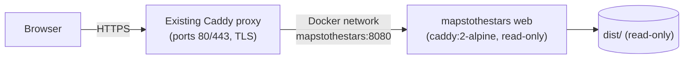

# Self-hosting behind an existing Caddy proxy

The app is a static bundle, so any static host works (Netlify, Vercel, GitHub
Pages, S3, nginx, …). This directory contains one opinionated option: run the
built `dist/` in a tiny, locked-down Caddy container on a server that **already
runs a Caddy reverse proxy** handling ports 80/443 and HTTPS certificates.



| File             | Purpose                                                                 |
| ---------------- | ----------------------------------------------------------------------- |
| `compose.yaml`   | Hardened static-file container joined to the proxy's Docker network     |
| `Caddyfile`      | Inner static server: compression, caching headers, `/healthz`           |
| `edge.Caddyfile` | Site block appended to the shared proxy's Caddyfile                     |
| `activate.sh`    | Validates, starts the container, safely merges and reloads proxy config |

## Container profile

- `caddy:2-alpine` reused from the existing proxy (`pull_policy: never`, no build)
- Runs as `nobody`, read-only root filesystem, all capabilities dropped except
  `NET_BIND_SERVICE`, `no-new-privileges`
- Ceilings: **128 MiB RAM**, **0.25 CPU**, 64 PIDs; bounded JSON logs
- No published host ports — only reachable through the proxy network
- Health check on `/healthz`; `restart: unless-stopped`

All astronomy, animation, saved Moments and exports run in the visitor's
browser, so server load is limited to serving static files.

## Configuration

`activate.sh` and `compose.yaml` read their settings from the environment. No
values are hard-coded.

| Variable                | Example                | Meaning                                     |
| ----------------------- | ---------------------- | ------------------------------------------- |
| `STARS_APP_DIR`         | `/srv/mapstothestars`  | Holds `releases/`, `backups/` and `current` |
| `STARS_HOSTNAME`        | `stars.example.com`    | Public hostname served by the proxy         |
| `STARS_PROXY_CADDYFILE` | `/srv/proxy/Caddyfile` | Host path of the shared proxy's Caddyfile   |
| `STARS_PROXY_CONTAINER` | `proxy-caddy-1`        | Name of the running proxy container         |
| `STARS_PROXY_NETWORK`   | `proxy_default`        | Docker network the proxy is attached to     |
| `STARS_DIST` (optional) | `../dist`              | Override the directory mounted as the site  |

A convenient pattern is an env file on the server, e.g. `~/.mapstothestars.env`,
sourced before running the helper.

## Deploy a release

Build locally so the server does no build work:

```sh
npm ci && npm test && npm run build

release_id="$(date -u +%Y%m%dT%H%M%SZ)"
COPYFILE_DISABLE=1 tar --no-xattrs -czf /tmp/mapstothestars.tgz dist deploy

ssh user@your-server "set -eu; . ~/.mapstothestars.env; \
  dir=\$STARS_APP_DIR/releases/$release_id; test ! -e \$dir; mkdir -p \$dir; \
  tar --no-same-owner -xzf - -C \$dir; chmod -R a+rX \$dir; \
  bash \$dir/deploy/activate.sh" < /tmp/mapstothestars.tgz

curl -fsS https://stars.example.com/healthz   # → ok
```

`activate.sh` then:

1. Checks the release lives under `$STARS_APP_DIR/releases/` and contains `dist/index.html`.
2. Validates the Compose file and the inner Caddyfile, starts the container and waits for health.
3. Backs up the shared proxy Caddyfile and the list of running containers.
4. Appends the `edge.Caddyfile` block (once; refuses if a _different_ block for the same hostname exists).
5. Validates the combined config inside the proxy container, then gracefully reloads it.
   If the reload fails, the previous config is restored and reloaded.
6. Points `$STARS_APP_DIR/current` at the new release.

The proxy is reloaded from a staged copy inside its container, and the host
Caddyfile is rewritten in place (preserving its inode) so read-only bind mounts
keep working across restarts. Other sites on the proxy are left untouched.

## Inspect

```sh
cd "$STARS_APP_DIR/current/deploy"
sudo --preserve-env=STARS_PROXY_NETWORK docker compose ps
sudo --preserve-env=STARS_PROXY_NETWORK docker compose logs --tail=50 web
sudo docker stats --no-stream mapstothestars-web-1
```

## Roll back

Keep previous release directories while they may be needed — they provide the
read-only bind mounts. To roll back the app, activate an earlier release:

```sh
bash "$STARS_APP_DIR/releases/PREVIOUS_RELEASE/deploy/activate.sh"
```

To remove the site from the proxy entirely, restore a Caddyfile snapshot from
`$STARS_APP_DIR/backups/<timestamp>/Caddyfile`: copy it into the proxy container,
`caddy validate` it, write it back to `$STARS_PROXY_CADDYFILE` in place, `caddy
reload`, then `docker compose stop web`. If the proxy configuration changed
after the snapshot was taken, remove the site block by hand instead.
