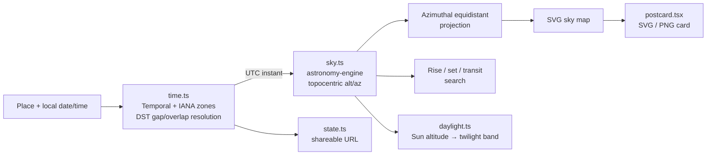

# Astronomy, time and validation



### Scientific model

[`astronomy-engine`](https://github.com/cosinekitty/astronomy) defines the eight J2000 stars with `DefineStar` and computes topocentric equatorial coordinates of date (precession, nutation, aberration), then converts them to altitude/azimuth. Lunar position includes topocentric parallax; phase and illuminated fraction are calculated independently of the icon.

Catalogue values are rounded J2000/ICRS coordinates, approximate V magnitudes and distances from [CDS SIMBAD](https://simbad.cds.unistra.fr/simbad/): **Polaris, Sirius, Vega, Arcturus, Betelgeuse, Rigel, Aldebaran and Capella.** Variable-star magnitudes are representative. No decorative points are presented as calculated stars.

The map uses an azimuthal equidistant projection:

```text
r = R × (90 − altitude) / 90
x = cx + r × sin(azimuth)
y = cy − r × cos(azimuth)
```

Only object centres at or above 0° altitude are drawn. Rise/set times are the next **geometric centre** crossings within 48 hours, found by 10-minute sampling and bisection to under one second; transit is the next upper meridian passage. Circumpolar and never-rising stars get explicit statuses. The observer is at sea level.

Solar context uses the same topocentric, unrefracted model. Twilight bands use centre altitudes of −6°, −12° and −18° ([USNO definitions](https://aa.usno.navy.mil/faq/RST_defs)). The app's 0° daylight boundary matches its geometric map and therefore differs slightly from conventional sunrise/sunset, which include the solar radius and refraction.

### Historical clock handling

[`@js-temporal/polyfill`](https://github.com/js-temporal/temporal-polyfill) converts wall time through the runtime's IANA time-zone database. The UI rejects spring-forward gaps and asks you to choose the earlier or later occurrence in fall-back overlaps, showing offsets and UTC timestamps. Calendar jumps preserve wall time; 24-hour jumps and playback operate on UTC instants.

URL state is `lat`, `lon`, `tz`, `place` and an ISO UTC timestamp `at`. Invalid or out-of-range links fall back to the default moment with a visible notice.

```text
/?lat=41.0082&lon=28.9784&tz=Europe%2FIstanbul&place=Istanbul&at=2026-01-15T19%3A00%3A00.000Z
```

## Validation

**74 automated unit tests** (Vitest) cover:

- **45 independent position comparisons** — eight stars + Moon at five moments — against PyEphem 4.2.1 / libastro with refraction disabled in both engines. Cases include Istanbul (July 1998, January 2026), Sydney (January 2026), and January 1900/2100. **All angular separations are under 0.08°**; lunar illuminated-fraction differences are under 0.5 percentage points.
- Polaris circumpolarity, southern-hemisphere visibility, rise/set crossing direction and transit maxima.
- Projection geometry and 359° → 0° continuity.
- Trail fading, endpoints and deterministic reconstruction after jumps in either direction.
- Solar band boundaries, continuous tint, and polar seasonal behaviour.
- Moments round trips, corruption handling, denied/full storage and limits; SVG card metadata and escaping.
- Pre-2016 Turkish offsets and the delayed November 2015 transition, New York gaps/overlaps, Sydney and fractional-offset India.
- Calendar arithmetic, query validation and exact share-link round trips.

Ten Playwright browser checks run against the production build across desktop and mobile layouts: automatic date/time updates, DST gaps and overlaps, post-crossing event jumps, approximate light-travel years, and standalone font/PNG exports.

<details>
<summary>Regenerating the PyEphem reference fixtures (optional)</summary>

The fixtures live in `src/lib/__fixtures__/pyephem.json`. Python is not needed for the app or normal tests.

```sh
python3 -m venv /tmp/maps-to-the-stars-reference-venv
/tmp/maps-to-the-stars-reference-venv/bin/pip install ephem==4.2.1
/tmp/maps-to-the-stars-reference-venv/bin/python scripts/generate-references.py
```

These comparisons are engineering checks, not observatory-grade certification. See the [PyEphem documentation](https://rhodesmill.org/pyephem/quick.html).

</details>

## Deliberate limits

> [!NOTE]
> This is a **reconstructed astronomical sky, not a photograph.** Clouds, light pollution, terrain, extinction and refraction are not modelled; an object above the horizon may not be visible to the eye.

- Star proper motion is omitted (precession and nutation are included). Accuracy suits a visual explorer, not telescope pointing or navigation.
- Near a grazing horizon, rise/set pairs shorter than the 10-minute sampling interval may be missed. At the geographic poles, a daily highest point is degenerate.
- The Moon icon is schematic: its bright limb isn't rotated to the observer's sky orientation. Apparent sizes are symbolic.
- Early-1900s civil-time records may be incomplete and vary between platforms; future offsets follow currently installed rules. The UTC timestamp in the URL always fixes the instant.
- The bundled city list is small and hand-curated — no geocoder, map tiles, AI features, constellation overlay or backend.
- No service worker. Once loaded, calculations and city search need no network. Geolocation is optional and may require HTTPS outside localhost.
